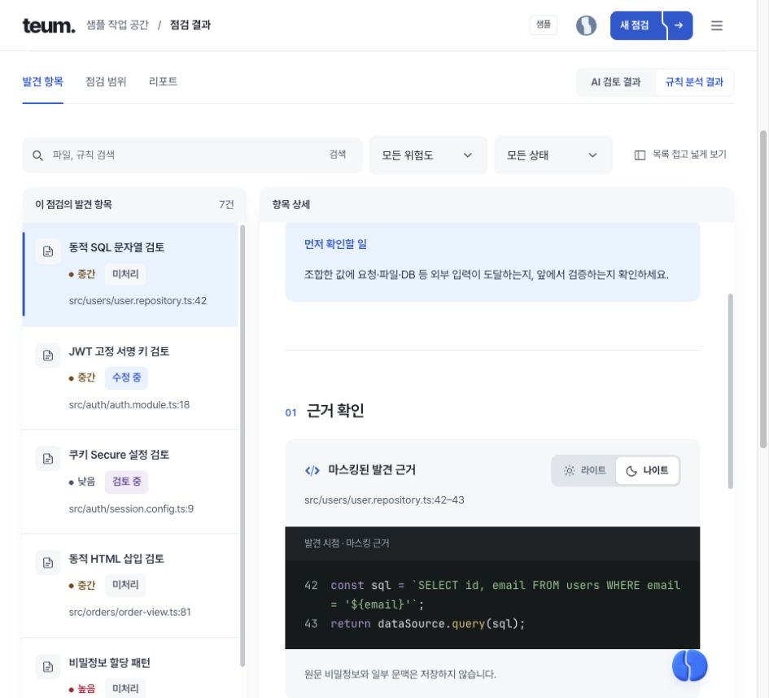

  

# teum.(틈)

teum은 GitHub에 올린 코드에서 **배포 전에 확인할 보안 위험을 찾는 서비스**입니다. 
근거를 읽고, 수정한 코드를 다시 확인할 수 있습니다. 
위험한 코드 패턴, 노출된 키·토큰, 외부 패키지의 알려진 취약점을 기본으로 점검합니다. 
선택한 경우 AI가 관련 코드를 읽으며 위험 후보와 방어 조건을 추가로 검토합니다. 
결과마다 어디를 확인했고 무엇을 확인하지 못했는지 함께 보여줍니다.

기획 · 제품 UI · 웹/서버 구현 · 분석 파이프라인 · 검증과 배포

**[서비스 ↗](https://teum.today) · [로그인 없이 샘플 체험 ↗](https://teum.today/demo) · [구현 이야기](docs/ENGINEERING.md) · [검증과 한계](docs/VALIDATION.md)**

> 이 저장소는 teum의 제품과 구현 과정을 소개하는 공개 문서입니다. 
> 애플리케이션 소스는 비공개로 관리합니다. 아래 화면은 공개 체험용으로 작성한 샘플이며, 실제 고객 코드나 분석 결과가 아닙니다.

 
 

## 01. 위험을 찾은 다음, 무엇을 해야 할까요?

작동하는 서비스를 만들었다고 해서, 그 안의 권한 처리와 비밀정보까지 확인한 것은 아닙니다. 
점검 도구가 위험을 알려줘도 파일 이름과 경고 목록만으로는 무엇부터 고쳐야 할지 판단하기 어렵습니다.

teum에서는 **발견 → 근거 확인 → 검토 기록 → 수정본 재점검**을 한 작업 공간에서 진행합니다. 
결과 목록 옆에서 코드와 설명을 읽고, 수정 방향을 검토한 뒤 같은 항목이 다시 발견되는지 확인할 수 있습니다.

*공개 샘플 화면 · 2026-10-14 캡처. 화면의 발견 건수는 제품 설명을 위한 예시입니다.*

 

### 한 항목에서 확인할 수 있는 것

| 확인할 질문 | 화면에서 볼 수 있는 정보 |
|---|---|
| 어디에 문제가 있나요? | 파일·줄 위치와 마스킹된 코드 근거 |
| 왜 확인해야 하나요? | 위험이 생기는 조건, 영향, 먼저 확인할 일 |
| 어떻게 고치나요? | 수정 방향과, AI 후보의 경우 검토용 코드 변경 예시 |
| 어디까지 검토했나요? | 담당 여부, 처리 상태, 위험 수용 기록 |
| 고친 뒤에는 달라졌나요? | 비교 조건을 확인한 재점검 결과와 HTML/JSON 리포트 |

처리 상태를 바꾸는 것과 실제로 다시 점검하는 것은 구분합니다. 
담당자가 검토를 마쳤다는 기록만으로 이전 분석 결과를 ‘해결’로 바꾸지 않습니다.

 
 

## 02. 저장소 연결부터, 수정 후 확인까지

*[SVG 크게 보기](assets/diagrams/review-flow.svg) · 움직임은 단계의 연결을 설명하며 실제 실행 시간이나 진행률을 나타내지 않습니다.*

1. **확인할 코드를 정합니다.** GitHub App에 허용한 저장소에서 브랜치와 폴더를 선택합니다. 수집할 파일을 확인하고, 특정 커밋의 코드로 입력을 고정합니다.
2. **점검을 시작합니다.** 기본 보안 점검을 실행합니다. AI 검토는 별도 선택과 코드 전송 동의가 있을 때 추가합니다.
3. **근거를 읽고 기록합니다.** 규칙 분석과 AI 후보를 구분해 보고, 성립 조건과 확인하지 못한 부분을 살펴봅니다.
4. **수정한 코드를 다시 확인합니다.** 새 커밋으로 재점검하고, 비교 가능한 항목의 변화를 확인합니다. 결과는 HTML/JSON으로 내보낼 수 있습니다.

 

### 기본 점검과 AI 검토가 맡는 일

| 구분 | 확인하는 내용 | 결과를 읽는 기준 |
|---|---|---|
| 정적 규칙 분석 | JavaScript·TypeScript·Python의 위험한 코드 패턴과 지원하는 입력 흐름 | 규칙과 해당 코드 근거를 함께 확인 |
| 비밀정보 탐지 | 코드에 들어간 키·토큰 등 비밀정보의 형태 | 값은 마스킹하고 발견 위치를 제공 |
| 의존성 대조 | 지원하는 잠금 파일·고정 버전 목록을 OSV 공개 취약점 정보와 대조 | 해당 패키지의 실제 실행·공격 가능성은 별도 확인 |
| 선택 AI 검토 | 관련 코드를 읽고 독립적인 위험 후보와 방어 근거를 검토 | 규칙 결과와 별도 표시하며, 사람이 검토할 후보로 제공 |

현재 새 점검 입력은 **GitHub 연결**입니다. 
직접 ZIP 업로드, 임의 웹사이트 점검, 자동 PR 점검은 제공하지 않습니다.

**[샘플로 따라 해 보기 →](docs/DEMO.md)**

 
 

## 03. 짧은 웹 요청과 긴 분석 작업을 나눴습니다

화면에서 점검을 시작하는 요청은 짧게 끝나지만, 코드 수집과 분석·정리는 그 뒤에도 이어져야 합니다. 
Next.js는 화면과 API를 처리하고, Workflow는 후속 작업을 이어 갑니다. Sandbox에서는 격리된 정적 분석을 실행합니다.

*[SVG 크게 보기](assets/diagrams/architecture.svg) · 세부 API와 내부 식별자를 생략한 구현 구조입니다.*

| 구성 | 사용 기술 | 맡은 역할 |
|---|---|---|
| 웹 화면·API | Next.js App Router · React · TypeScript | 공개 홈과 작업 공간, 입력 검증과 권한 검사 |
| 계정·데이터 | Supabase Auth · PostgreSQL · private Storage | 로그인, 작업과 결과 기록, 비공개 입력 보관 |
| 작업 실행 | Vercel Workflow | 코드 수집, 분석 단계, 재시도와 정리 |
| 격리 분석 | Vercel Sandbox · Semgrep CE · Gitleaks | 고정 도구로 코드와 비밀정보 분석, 의존성 목록 추출 |
| 외부 대조·검토 | OSV · OpenAI Responses API | 공개 패키지 취약점 대조, 동의한 코드의 선택 AI 검토 |
| 화면 표현 | CSS · GSAP · Shiki | 브랜드 모션, 코드 구문 강조와 변경 비교 |

Sandbox 안에서는 네트워크를 차단하고 고객 코드의 설치·빌드·실행을 하지 않습니다. 
OSV에는 공개 패키지 이름과 버전을 보내며, AI를 선택하면 동의한 범위의 코드 문맥을 별도로 보냅니다. 
두 외부 호출은 Sandbox 밖의 서버 단계에서 수행합니다.

GitHub 수집과 분석은 별도 Workflow로 실행합니다. 수집한 입력을 저장한 뒤, **Sandbox 분석 → OSV 조회 → 선택 AI 검토 → 정리** 순서로 진행합니다. 
GitHub 파일 수집은 최대 8개, OSV 조회는 최대 4개 요청을 병렬로 처리합니다. Sandbox 분석과 AI 검토를 동시에 실행하는 구조는 아닙니다.

**[계층 구조·작업 수명주기·기술 선택 자세히 보기 →](docs/ENGINEERING.md)**

 
 

## 04. 구현에서 중요했던 네 가지 판단

### 1. ‘발견 0건’과 ‘확인하지 못함’을 구분하기

분석이 실패했는데 빈 목록을 보여주면 사용자는 문제가 없다고 받아들일 수 있습니다. 
완료·부분 완료·실패·미지원·취소를 구분하고, 일부 파일에서 실패해도 정상 파일의 검증된 근거와 미완료 범위를 함께 남겼습니다.

 

### 2. AI가 말한 내용을 코드와 다시 대조하기

AI 검토는 후보를 찾은 뒤 별도 단계에서 방어 근거와 반례를 살펴봅니다. 
서버는 인용한 파일·줄·내용이 실제 제공한 코드와 일치하는지 검사하고, 읽은 범위를 기록합니다. 
AI의 제안은 규칙 결과와 별도로 저장하며, 수정 예시는 자동 적용하거나 병합하지 않습니다.

*AI 검토 화면도 고정 샘플입니다. 실제 모델의 성능을 입증하는 자료가 아닙니다.*

 

### 3. 요청이 끊겨도 작업을 추적할 수 있게 만들기

작업과 실행 요청을 DB에 함께 남기고, Workflow가 실행 상태를 이어받도록 했습니다. 
재시도나 중복 전달이 생겨도 현재 작업의 실행권과 상태를 확인하며, 취소·삭제된 작업의 늦은 결과는 저장하지 않도록 검사합니다. 
분석 환경 종료와 원본 자료 삭제도 각각 확인한 뒤 기록합니다.

 

### 4. 재점검을 단순한 숫자 비교로 끝내지 않기

발견 건수가 줄어도 규칙이 달라졌거나 해당 파일을 읽지 못했다면 수정 효과라고 단정할 수 없습니다. 
엔진·규칙·파일의 점검 완료 범위를 대조해 비교하고, 조건이 맞지 않으면 판단을 보류합니다. 
AI 후보의 자동 재점검 비교는 현재 지원 범위에서 제외했습니다.

 
 

## 05. 기능을 연결하면서 제품도 바뀌었습니다

| 과정 | 제품과 구현의 변화 |
|---|---|
| 시안에서 실제 앱으로 | React 화면과 인증·DB·분석 경로를 구현하고 공개 홈과 실제 작업 공간을 분리 |
| 입력을 GitHub로 정리 | 저장소·폴더를 선택하고 고정 커밋을 수집하는 방식으로 새 점검과 재점검을 통일 |
| 기본 점검 보강 | JS/TS·Python 정적 규칙, 비밀정보 탐지, 공개 의존성 취약점 대조를 연결 |
| AI 역할 확장 | 근거 해설 중심에서 독립 후보 발견·반증 검토로 확장하고 결과 출처를 분리 |
| 검토 화면 다듬기 | 목록과 상세, 근거 코드와 수정 예시, 처리 기록을 같은 흐름 안에 배치 |
| 실패와 재점검 보강 | 부분 완료, 동일 조건 비교, 취소와 원본 정리 복구를 검증 |

화면은 흰 바탕과 글자 계층, 파란 강조색을 유지했습니다. 
공개 홈에서는 서비스를 이해하도록, 작업 공간에서는 코드 근거를 읽고 다음 행동을 정하도록 정보의 순서를 달리했습니다.

 
 

## 06. 검증한 것과 더 확인할 것

**2026-10-13까지의 개발·운영 검증 기록**을 정리했습니다. 
단위 테스트, 실제 분석 엔진, 운영 흐름, 공개 샘플 화면의 확인을 서로 구분했습니다.

| 검증 층 | 확인한 내용 |
|---|---|
| 코드·계약 | 타입·린트·빌드, 입력·출력 계약, 비교 조건과 오류 처리의 회귀 검사 |
| 실제 분석 엔진 | 고정 엔진의 양성·음성 사례, 마스킹, 파싱 오류와 부분 결과 |
| DB·권한 | 작업 공간 접근 경계, 재시도·중복 결과·권한 변경과 저장 조건 |
| 운영 기본 점검 | AI를 끈 합성 대상 4회: 정상 점검, 재점검, 부분 완료, 준비 중 취소 |
| 공개 화면 | 샘플 결과와 범위·리포트 화면, 데스크톱·모바일 레이아웃 |

규칙 수와 테스트 통과 수는 실제 고객 저장소의 탐지율을 뜻하지 않습니다. 
AI를 포함한 전체 운영 인수 검증, 현재 모델의 후속 품질 평가, 지속 부하와 제공자 장애 상황의 추가 검증은 남아 있습니다. 
**발견 0건도 전체 서비스의 안전을 보장하지 않습니다.**

**[검증 조건과 지원 범위 자세히 보기 →](docs/VALIDATION.md)**

 
 

## 07. 이 저장소에서 볼 수 있는 자료

| 자료 | 내용 |
|---|---|
| [샘플 체험 안내](docs/DEMO.md) | 처음 방문한 사람이 확인할 화면과 순서 |
| [구현 이야기](docs/ENGINEERING.md) | 시스템 경계와 주요 기술 선택 |
| [검증과 한계](docs/VALIDATION.md) | 확인한 범위와 아직 확인하지 못한 부분 |
| [AI SDK 실험 r1~r15](docs/AI_SDK_R1_R15.md) | 회차별 수치·품질 판정과 요청·토큰·시간·비용 비교 |
| [이미지·SVG 안내](docs/ASSETS.md) | 공개 화면의 출처와 도식 읽는 방법 |

애플리케이션 코드·분석 규칙 원본·DB 마이그레이션·운영 설정·고객 자료는 이 저장소에 포함하지 않습니다.
