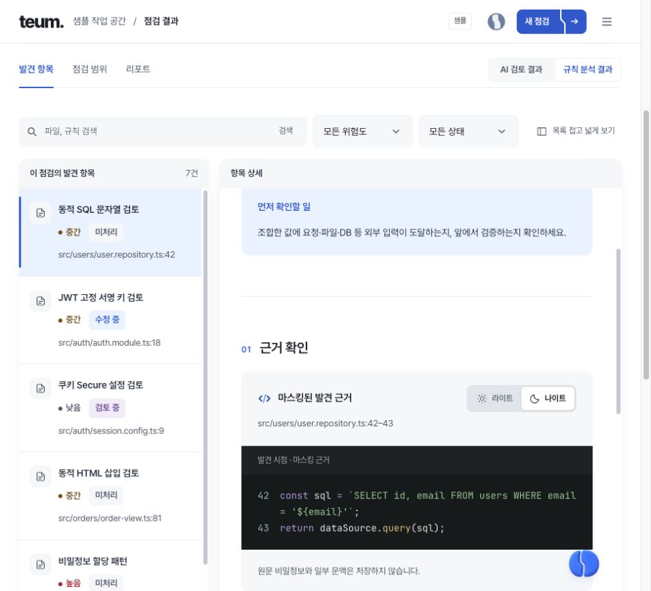

  <picture>
    <source media="(max-width: 640px)" srcset="assets/diagrams/hero-mobile.svg">
    
  </picture>

# teum.(틈)

GitHub 코드에서 보안 위험을 찾고, 근거 확인부터 수정본 재점검까지 이어가는 서비스입니다.
기획과 UI부터 웹/서버·분석 파이프라인 구현, 검증과 배포까지 맡았습니다.

**[서비스](https://teum.today) · [로그인 없이 샘플 체험](https://teum.today/demo/new) · [구현 이야기](docs/ENGINEERING.md) · [검증과 한계](docs/VALIDATION.md)**

현재 운영에서는 **규칙·비밀정보·의존성 점검과 자체 코드 분석**을 제공합니다. AI 개선안은 로컬 검증 후 보존했으며 **운영에 배포하지 않았습니다**. 샘플의 AI 화면은 준비된 예시로 체험할 수 있습니다.

이 저장소는 공개 포트폴리오입니다. 제품 소스와 실제 평가 입력·원본 응답은 비공개로 관리합니다.

## 근거를 읽고, 다음 행동을 정합니다

| 사용자 흐름 | 구현한 기능 |
|---|---|
| 점검 대상 선택 | GitHub 저장소·폴더를 고르고 특정 커밋으로 입력 고정 |
| 발견 항목 검토 | 파일·줄 위치, 마스킹한 근거, 수정 방향을 함께 확인 |
| 검토 기록 | 담당 여부·처리 상태·위험 수용 기록 |
| 수정본 재점검 | 비교 조건을 확인한 전후 결과와 HTML/JSON 리포트 |

발견 0건·부분 완료·실패·미지원을 구분합니다. 검토 상태를 바꿔도 스캐너가 관측한 결과는 바뀌지 않습니다.

## 현재 운영의 분석 흐름

<picture>
  <source media="(max-width: 640px)" srcset="assets/diagrams/rules-runtime-mobile.svg">
  
</picture>

움직임은 처리 순서를 설명합니다. 실행 시간이나 성능 향상을 나타내는 그래프는 아닙니다.

- **기본 점검:** 자체 JS·TS·Python 규칙, 비밀정보 탐지, 지원하는 패키지 목록의 공개 취약점 대조.
- **자체 분석:** 지원하는 TypeScript의 입력 흐름·객체 소유권 조건·서버에서 Client로 전달하는 데이터. 지원 범위와 미확인 조건을 함께 표시합니다.
- **입력 보호:** 격리된 분석 환경에서 고객 코드를 설치·빌드·실행하지 않습니다. 비밀값은 마스킹합니다.

| 구성 | 기술 |
|---|---|
| 화면·API | Next.js App Router · React · TypeScript |
| 계정·데이터 | Supabase Auth · PostgreSQL · private Storage |
| 후속 작업·격리 분석 | Vercel Workflow · Sandbox |
| 분석 | Semgrep CE · Gitleaks · OSV · 자체 분석기 |
| 로컬 AI 평가 | OpenAI Responses API |

작업 식별자와 상태를 DB에 저장하고 중복 실행·취소·삭제 이후의 늦은 결과를 검사합니다.
[아키텍처와 기술 선택](docs/ENGINEERING.md) · [DB 관계도](assets/diagrams/database.svg)

## 로컬 AI 최적화 사례

원문·모델·품질 기준을 유지하면서 코드 전송에 쓰는 표현을 줄였습니다. 같은 입력에서 총 토큰 평균이 **149,699 → 136,576개로 약 8.8% 감소**했습니다. 개선안 2회 모두 핵심 위험 3개와 정상 방어 5묶음을 확인해 최종 독립 QA를 통과했습니다.

<picture>
  <source media="(max-width: 640px)" srcset="assets/diagrams/ai-local-optimization-mobile.svg">
  
</picture>

평균 시간은 **9분 58초 → 9분 44초로 비슷한 수준**입니다. 현재 실행 구조는 [Vercel Hobby 함수의 300초 한도](https://vercel.com/docs/functions/limitations)에 맞지 않아 이 개선안은 로컬 실험으로 남겼습니다. 운영 서버에서는 AI 요청을 차단합니다.

[비교 조건·회차별 결과·QA 정정 이력](docs/AI_LOCAL_MIXED_20261116.md) · [실측 JSON](docs/verification/ai-local-evaluation-20261116.json)

이전 AI 실험과 그래프

각 실험은 입력과 비교 기준이 다릅니다. 아래 자료는 당시 기록이며 현재 운영 성능을 나타내지 않습니다.

- [Codex SDK r1~r15](docs/AI_SDK_R1_R15.md) · [당시 동적 그래프](assets/diagrams/sdk-r1-r15.svg)
- [11월 7일 제품 AI 실험](docs/AI_MVP_OPTIMIZATION_20261107.md): 제한된 7사례에서는 절감을 관측했지만 큰 표본에서 후보가 누락돼 채택을 철회했습니다.

## 샘플과 검증

[샘플 진입 화면](https://teum.today/demo/new)에서 **규칙 분석 / 규칙 + AI**를 고른 뒤 발견 있음·없음 결과를 살펴볼 수 있습니다. 추가 사례에는 AI만 발견·부분 완료·AI 실패·재점검을 모았습니다. 실제 분석이나 모델 호출은 일어나지 않습니다.

[샘플 이용 순서](docs/DEMO.md) · [검증 기록](docs/VALIDATION.md)

화면의 코드는 설명용 샘플입니다. 로컬 AI 비교도 알려진 고정 입력의 관측으로, 다른 코드의 정확도나 반복 실행의 속도를 보장하지 않습니다.
