# 로컬 AI 최적화 — 품질을 확인한 뒤 전송 토큰 줄이기

같은 고정 코드에서 총 토큰 평균을 **149,699 → 136,576개로 약 8.8% 줄였습니다.** 
개선안 2회 모두 핵심 위험 3개·정상 방어 5묶음의 독립 QA를 통과했습니다. 
평균 시간은 9분 58초 → 9분 44초로 비슷한 수준이었습니다.  

현재 실행 구조는 [Vercel Hobby 함수의 300초 한도](https://vercel.com/docs/functions/limitations)를 넘습니다. 
AI는 로컬에서만 검증하고 운영 적용을 보류했습니다. 운영에서는 규칙 분석을 제공하며, 샘플 AI는 준비된 예시입니다.  

[서비스 소개](../README.md) · [연구 과정](AI_RESEARCH_HISTORY.md) · [실측 JSON](verification/ai-local-evaluation-20261116.json)

 
 

## 01. 원문을 줄이지 않고, 전달 형식을 바꿨습니다

발견과 독립 반증에 같은 원문을 각각 제공했습니다. 
기존의 `[줄 번호, 원문]` JSON 쌍을 줄 번호와 원문을 이어 쓴 형식으로 바꿔, 반복되는 기호와 표기를 줄였습니다. 
모델 `gpt-6.1-sol`, 두 단계의 추론 강도 `high`, 원문 26파일·2,277줄, 출력 구조와 정확 인용 검사는 유지했습니다.  

**비교 기준은 품질 검증을 통과한 과거 로컬 기준안 3회 평균입니다.** 
Codex SDK r1~r15나 당시 운영 구성과 비교한 절감률이 아닙니다.  

<picture>
  <source media="(max-width: 640px)" srcset="../assets/diagrams/ai-local-optimization-mobile.svg">
  
</picture>

*[가로 SVG](../assets/diagrams/ai-local-optimization.svg) · [모바일 SVG](../assets/diagrams/ai-local-optimization-mobile.svg) · 2026-11-16~17 로컬 관측*  

## 02. 회차별 결과

| 구성 | 모델 요청/회 | AI 처리시간 | 입력 토큰 | 총 토큰 | 독립 QA |
|---|---:|---:|---:|---:|---|
| 과거 기준안 3회 평균 | 2 | 597.682초 | 118,442 | 149,698.7 | 매회 핵심3/3·방어5/5 |
| 개선안 1회 | 2 | 535.695초 | 111,295 | 134,829 | 핵심3/3·방어5/5 |
| 개선안 2회 | 2 | 631.552초 | 111,181 | 138,323 | 핵심3/3·방어5/5, 정정 판정 |
| **개선안 2회 평균** | **2** | **583.624초** | **111,238** | **136,576** | **두 회차 각각 통과** |

입력 토큰은 평균 6.08%, 총 토큰은 8.77% 적었습니다. 
시간 차이는 기존 회차의 편차 안에 있어 안정적인 속도 향상으로 확정하지 않았습니다. 
출력 길이와 캐시 적중도 달랐으므로 전체 차이를 전송 형식 하나의 효과로 단정하지 않습니다.  

둘째 회차는 QA가 원답에 없는 서버 전체의 재사용 차단 보장을 있다고 해석해 처음 탈락시켰습니다. 
같은 기준으로 원답을 재대조한 뒤 통과로 정정했고, 원답·초기 판정·기준은 그대로 보존했습니다. 
콜백에서 쿠키를 제거한다는 범위를 정확히 쓰라는 표현 권고는 남았습니다.  

## 03. 이 결과가 말하는 범위

시간은 준비된 입력의 **로컬 AI 엔진 구간**이며, 코드 수집·Workflow·DB 저장·화면 표시·별도 독립 QA 시간은 포함하지 않습니다. 
요청 수는 모델 API 호출만 셌고, 추론 토큰은 출력 토큰에 포함했습니다.  

알려진 같은 입력에서 확인한 두 관측입니다. 
다른 저장소의 탐지 정확도, SDK와의 동등성, 모든 입력의 속도 개선이나 최적화 완료를 뜻하지 않습니다. 
이전 실패와 혼합 후보의 단일 통과도 [연구 과정](AI_RESEARCH_HISTORY.md)에 함께 남겼습니다. 
