# teum. — 실제 제품 AI 검토 최적화

**측정일: 2026-11-07.** 현재 화면에 필요한 보고서를 기준으로 제품의 OpenAI Responses 경로를 재설계했습니다. 
같은 자체 품질 대조 7사례를 개선 전·최종 구현에서 각각 한 번 실행해, 합계 **시간 33.3%·총토큰 66.3%·보수 추정 비용 56.9% 감소**를 관측했습니다. 
선택한 7사례의 기준은 두 버전 모두 통과했습니다. 일반 저장소의 탐지율이나 전체 서비스 처리 시간에 대한 보장은 아닙니다.  

[서비스 소개](../README.md) · [공개 측정값 JSON](verification/ai-mvp-20261107.json) · [이전 SDK r1~r15 기록](AI_SDK_R1_R15.md)

 
 

## 01. 무엇을 줄였나요?

UI의 목록·상세·범위·리포트가 실제로 사용하는 정보부터 확인했습니다. 
사용자에게 필요한 위험 후보·근거·성립 조건·반대 근거·수정 방향은 남기고, 생성 단계 사이의 중복을 줄였습니다.  

| 구간 | 개선 전 제품 | 최종 제품 | 줄이려는 낭비 |
|---|---|---|---|
| 조사 설명 | 계획·개요·질문·조사 결과를 함께 생성 | 질문과 확인 결과를 한 번 기록 | 같은 판단을 여러 형식으로 작성 |
| 수정 방향 | 발견 단계에서도 모든 후보의 수정안·확인 절차 생성 | 독립 검증자가 유지한 후보에만 생성 | 나중에 버릴 후보의 설명 생성 |
| 원문 전달 | 필요한 원문을 여러 도구 요청으로 읽음 | 각 단계의 별도 reader에서 예산 안의 전량을 먼저 공급 | 목록·원문을 다시 요청하는 왕복 |
| 추가 읽기 | 충분한 원문을 받아도 모델이 다시 요청할 수 있음 | 해당 단계에 전체 입력을 제공했을 때만 도구를 닫음 | 이미 전달한 줄의 반복 조회 |
| 지침·예산 | 변하는 예산 안내가 요청 앞부분에 포함 | 고정 지침을 유지하고 변동 예산은 뒤에 추가 | 앞부분 재사용·캐시를 방해하는 변경 |
| 추론 강도 | 발견과 독립 반증 모두 high | 발견 medium, 독립 반증 high | 두 역할에 같은 추론 비용을 배정 |

후보가 없는 사례는 조사 1요청으로 끝났고, 후보가 있는 세 사례는 조사 1회와 별도 반증 1회로 끝났습니다. 
이번 7사례에서 **4×1 + 3×2 = 10요청**이 된 이유입니다. 기존에도 후보가 없으면 반증을 생략했으므로, 이 생략 자체를 새 성과로 세지 않았습니다.  

독립 반증은 발견 단계의 읽기 승인을 복사하지 않고 같은 스냅샷을 별도 reader에서 다시 읽습니다. 
전체 원문이 예산에 맞지 않으면 추가 읽기를 허용하며, 읽지 못한 범위는 미확인으로 남깁니다. 
서버가 위치 인용을 정확한 원문으로 복원하고, 최종 화면의 내용도 검증자가 정리한 결과로 조립합니다. 
거절·실패·취소·미확인과 정상 0건의 구분도 유지했습니다.  

이 비교는 여러 변경을 묶어 평가한 결과입니다. 
각 변경의 효과를 하나씩 분리한 실험은 아니므로, 절감 전부를 추론 강도나 캐시 하나의 효과로 설명하지 않습니다. 
입력 토큰이 줄어도 최종 답변 생성과 추론에 걸리는 시간은 남아, 시간 감소율이 토큰 감소율과 같지는 않습니다. 

 
 

## 02. 같은 7사례의 비교표

| 비교 조건 | 내용 |
|---|---|
| 실행 경로 | 실제 제품의 OpenAI Responses 검토 서비스 |
| 모델·SDK | `gpt-6.1-sol` · OpenAI SDK `7.23.0` · service tier `default` |
| 입력 | 동일한 자체 회귀 7사례의 마스킹된 코드 |
| 반복 | 기준본·최종본 각각 1회. 중간안의 결과를 평균에 합치지 않음 |
| 측정 시간 | AI 검토 함수의 시작부터 완료까지. 저장소 수집·스캐너·전체 사용자 여정 시간은 아님 |
| 품질 확인 | 예상 후보 수, 실제 방어 이유·주체·미확인, 최종 인용과 독립 열람 범위를 대조 |
| 비용 | 입력 $2.5 / 출력 $10 per 1M tokens의 기존 보수 추정. 캐시 할인 없음·청구액 아님 |

| 지표 · 7사례 합계 | 개선 전 제품 | 최종 제품 | 변화 |
|---|---:|---:|---:|
| 품질 기준 |7/7|7/7|유지|
| AI 검토 시간 |302.418초|201.854초|33.3% 감소|
| API 요청 |29회|10회|65.5% 감소|
| 입력 토큰 |161,898|46,557|71.2% 감소|
| 출력 토큰 |23,328|15,856|32.0% 감소|
| 총토큰 |185,226|62,413|66.3% 감소|
| 보수 추정 비용 |$0.638025|$0.2749525|56.9% 감소|

<picture>
  <source media="(max-width: 640px)" srcset="../assets/diagrams/sdk-optimization-mobile.svg">
  
</picture>

### 사례별 결과

아래 시간과 토큰은 각 사례의 실제 기록입니다. 토큰은 입력과 출력의 합계이며 추론 토큰을 출력에 다시 더하지 않았습니다.  

| 자체 사례 | 시간 · 전→후 | 요청 · 전→후 | 총토큰 · 전→후 | 최종 확인 |
|---|---:|---:|---:|---|
|객체 인가 위험|56.070→51.819초|6→2|39,687→13,623|후보 유지|
|소유자 조회 방어|38.608→13.548초|3→1|18,540→5,565|0건·방어 설명|
|호출부 소유자 방어|36.237→11.943초|4→1|23,816→5,470|0건·방어 설명|
|인가 helper 입력 부재|35.228→13.719초|3→1|18,293→5,454|0건·인가 구현 미확인|
|악성 주석이 있는 위험 사례|57.146→47.891초|6→2|40,705→13,711|후보 유지|
|느슨한 RLS|52.043→50.964초|5→2|32,541→13,392|후보 유지|
|소유자 RLS 방어|27.086→11.970초|2→1|11,644→5,198|0건·방어 설명|

| 사례 묶음 | 개선 전 합계 | 최종 합계 | 시간 변화 |
|---|---:|---:|---:|
|후보를 남긴 3사례|165.259초|150.674초|8.8% 감소|
|후보가 없는 4사례|137.159초|51.180초|62.7% 감소|

후보를 남긴 세 사례에서는 여전히 상세 작성과 독립 반증이 필요해 시간 절감이 작았습니다. 
후보가 없는 네 사례에서는 반복 읽기와 중간 설명을 줄인 효과가 더 크게 나타났습니다. 
구현이 빠진 인가 helper 사례의 0건은 안전 판정이 아니라, 확인할 수 없는 방어를 명시한 결과입니다. 

 
 

## 03. 큰 표본에서도 빨라졌나요?

자사 코드 26파일·2,277줄의 별도 고정표본에서는 속도 향상을 확인하지 못했습니다. 
개선 전 실행은 원문 일부만 전달하고 사전에 확인한 중요 후보를 놓쳤으므로, 빠른 0건을 같은 품질의 기준으로 삼을 수 없습니다.  

| 실행 | 시간 | 요청 | 입력 / 출력 토큰 | 확인 결과 |
|---|---:|---:|---:|---|
| 개선 전 제품 |83.307초|4|96,655 / 6,468|1,603줄 전달·중요 후보 누락|
| 최종 실행 1 |119.183초|5|121,599 / 8,890|2,277줄 전달·중요 조건부 후보 독립 유지|
| 최종 실행 2 |111.667초|5|124,987 / 9,154|2,277줄 전달·같은 중요 조건부 후보 독립 유지|

두 최종 실행은 240초 안에 완료했고, 운영 조건과 반대 근거를 남겼습니다. 
하지만 과거의 추가 조건부 후보 일부는 다시 나오지 않았습니다. 전체 원문을 제공했다고 모든 위험을 분석한 것은 아닙니다.  

이전 SDK 실험의 4흐름·16복합조건 전체 설명도 새 제품 계약에서는 강제하지 않습니다. 
첫 최종 실행은 12조건 일부 설명·4조건 명시 설명 없음, 두 번째는 1조건 전체·14조건 일부·1조건 명시 설명 없음으로 별도 기록했습니다. 
**이 결과를 SDK의 16/16 유지나 동일한 탐지 품질로 발표하지 않습니다.** 사용자에게 필요한 후보와 미확인을 중심으로 보고서를 구성한 선택과 그 한계를 함께 남깁니다. 

 
 

## 04. 실패한 시도도 보존했습니다

아래는 이번 재설계의 14개 실행 기록입니다. 7사례 배치도 실행 기록 하나로 세어 전체 평가 대상은 32건입니다. 
API 완료와 채택 판정은 다릅니다. 실패 회차의 빠른 종료를 성능 향상으로 계산하지 않았습니다.  

| 기록명 | 대상 | API 결과 | 시간 | 보수 비용 | 판정 |
|---|---|---|---:|---:|---|
|baseline-1|26파일|완료|83.307초|$0.3063175|큰 고정표본 기준. 원문 일부와 중요 후보 누락|
|quality-baseline-1|7사례 합계|완료|302.418초|$0.6380250|7품질사례 비교 기준·7/7|
|compact-1|26파일|완료|76.055초|$0.3040125|출력 축약만으로 원문·핵심 조사 부족을 해소하지 못함|
|prefetch-1|26파일|완료|108.969초|$0.4222775|선공급 뒤 원문 재요청으로 더 느려져 제외|
|cache-1|26파일|실패|57.512초|$0.3800475|누적 입력 한도 도달, 최종 보고서 없음|
|final-1|26파일|실패|152.407초|$0.4380775|high 발견이 출력 한도에 도달, 최종 보고서 없음|
|mixed-1|26파일|실패|73.649초|$0.4028800|긴 위치 인용의 복원 오류로 실패|
|quality-1|7사례 합계|완료|214.561초|$0.3796800|중간안7/7. 최종 비교 수치에 합치지 않음|
|bounded-1|26파일|실패|88.930초|$0.4872700|후보 발견 후 독립 검증 최종 요청 전에 입력 한도 도달|
|whole-1|26파일|완료|104.532초|$0.3705450|전량 공급 완료. 큰 표본 비교의 중간안|
|focused-1|26파일|완료|132.716초|$0.5385700|후보 파일 전체 선공급에서 입력·시간 증가, 제외|
|release-1|26파일|완료|119.183초|$0.3928975|최종 큰 표본1·중요 조건부 후보 유지|
|quality-2|7사례 합계|완료|201.854초|$0.2749525|최종7품질사례·7/7, 성과표의 최종값|
|release-2|26파일|완료|111.667초|$0.4040075|같은 최종본의 큰 표본2·중요 조건부 후보 유지|

전체 보수 추정 비용은 **$5.73956**, usage 미수신은 0건입니다. 
기존 요청 상한·출력 상한·전체 240초와 자동 재시도 0을 유지했습니다. 
입력 상한은 180k→220k로 조정했습니다. 첫 요청을 UTF-8 bytes로 보수 예약할 때 실제 약49k토큰의 전량 입력이 거절되던 문제를 해결하기 위한 여유이며, 상한 증가 자체를 절감으로 세지 않습니다.  

긴 위치 인용을 원문 줄 경계에서 나누고, 마스킹·공백만 남는 꼬리가 정상 검토를 실패시키는 문제도 수정했습니다. 
분할 뒤에도 80줄·3,000자·총8개 인용과 미열람·마스킹 전용·비밀값 거절 기준을 유지했습니다. 
새 플랫폼·그래프·외부 MCP·벡터 DB·추가 모델은 도입하지 않았습니다. 

 
 

## 05. 검증과 공개 범위

| 검증 | 확인한 범위 |
|---|---|
| 무료 전체 경로 13개 | 실제 SDK + 가짜 제공자, 고정 실제 입력 크기·관측 도구 인자/순서·다음 요청 원문·최종 조립·정확 인용 |
| 회귀 | Node808개·Python119개 통과, 기존3개 생략 |
| 정적·빌드 | 타입·린트·운영 빌드 통과. 기존 빌드 경고2종 유지 |
| 표시 계약 | 실제 최종 보고서를 기존 목록·상세·범위 컴포넌트에 넣어 렌더링 |
| 독립 검토 | Astra/max 설계·코드 자문, 인용 분할 경계의 재현·수정·재검토 |
| 반영 | 제품 main 병합·CI·Vercel 자동 배포 성공과 운영 홈/AI 샘플 HTTP200 확인 |
| 원자료 보존 | 비공개 저장소의 실행본·응답·실패·무료 증거399파일을 해시 검사·복원 확인 |

무료 재생은 실제 모델의 의미 이해나 속도를 새로 측정한 결과가 아닙니다. 
저장된 응답에는 encrypted reasoning 원문이 없어 byte-identical 재생이라고 주장하지 않습니다. 
이번 작업에서 새 실사용자 계정으로 GitHub 수집부터 운영 분석·저장까지 다시 실행하지는 않았습니다.  

공개 JSON에는 사례별 지표·전체 합계·비교 조건·실행 기록의 해시를 담았습니다. 
코드 원문·모델 원 응답·운영 취약점 상세·키·계정 정보는 공개하지 않으며, 공개 수치만으로 코드 판단을 독립 재현할 수는 없습니다. 
이 공개 문서를 작성하면서 추가 유료 API를 호출하지 않았습니다.  

이전 [개발용 SDK r1~r15](AI_SDK_R1_R15.md)는 별도 경로·출력 계약·품질 기준의 기록입니다. 
개발용 SDK 계열에서 기록한 803초나 18분을 이번 제품 개선 전 수치로 사용하거나, 서로 다른 절감률을 이어 곱하지 않습니다. 
미사용 저장소의 후보 안정성·운영 지연 분포·실제 배포 권한과 경합은 후속 검증으로 남습니다. 
