# 규칙 분석: 최초 구현에서 현재 구성까지

처음에는 JS/TS 코드 패턴과 비밀정보 형태를 찾는 작은 검사로 시작했습니다. 
이후 Python 규칙과 프레임워크 입력을 늘리고, 함수·파일 사이의 흐름과 객체 소유권, 서버 데이터 전달을 별도로 읽도록 보강했습니다. 
현재 운영은 이 규칙·정적 분석 경로를 사용합니다.  

[서비스 소개](../README.md) · [AI 연구 과정](AI_RESEARCH_HISTORY.md) · [측정값과 출처](verification/rules-evolution-20261117.json)

 
 

<picture>
  <source media="(max-width: 640px)" srcset="../assets/diagrams/rules-optimization-mobile.svg">
  
</picture>

*[가로 SVG](../assets/diagrams/rules-optimization.svg) · [모바일 SVG](../assets/diagrams/rules-optimization-mobile.svg) · 규칙 수는 탐지 정확도나 속도를 뜻하지 않습니다.*  

## 01. 규칙 수와 입력 범위를 늘렸습니다

최초 기준은 **2026-09-29 첫 구현 `04920aa`**, 현재 기준은 **2026-11-17 확인한 운영 코드 `53a103c`**입니다. 
실제 규칙 파일의 고유 ID를 셌고, JavaScript와 TypeScript는 하나의 공통 묶음으로 집계했습니다.  

| 항목 | 최초 구현 | 현재 |
|---|---:|---:|
| JS/TS 자체 정적 규칙 | 3 | 39 |
| Python 자체 정적 규칙 | 0 | 35 |
| 비밀정보 규칙 | 자체 3 | 자체 9 + MIT 기본 218 = 227 |
| 공개 패키지 취약점 대조 | 미지원 | 지원하는 잠금 파일·고정 버전을 OSV와 대조 |

Semgrep CE **1.178.0**과 Gitleaks **8.30.1**은 유지했습니다. 
규칙을 늘리는 동안 입력이 전달되는 API와 정상 대조도 함께 보강했습니다. 
FastAPI 모델 필드·Next.js 요청 입력, SQL 바인딩과 HTML 출력 문맥은 같은 규칙 안에서 넓힌 범위입니다. 
새 ID로 중복 계산하지 않았습니다.  

## 02. 단순 패턴 밖의 근거를 읽습니다

| 추가 분석 | 확인하는 내용 |
|---|---|
| 입력 흐름 | 지원하는 TypeScript 호출·import를 따라 SQL 텍스트와 셸 명령으로 이어지는 입력을 확인 |
| 객체 소유권 | 사용자가 선언한 제한된 소유자 정책과 조회·변경·삭제 경로의 조건을 대조 |
| 서버 데이터 전달 | 지원하는 서버 페이지의 조회·보호 조건·Client 전달 흐름을 기록 |

지원하던 Promise 입력 전달의 누락, 고정 SQL 텍스트와 바인딩 값의 혼동, 앞 경로의 결과가 유실되던 경우도 수정했습니다. 
객체 소유권의 정적 근거가 실제 고객 DB의 RLS 집행을 입증하거나, 서버 데이터 전달 기록 자체가 취약점을 뜻하지는 않습니다.  

## 03. 같은 조건의 재점검에서는 본 분석을 줄입니다

입력·규칙·엔진·정책과 현재 접근 권한이 맞으면 저장된 전체 자체 분석 결과를 재사용합니다. 
입력 준비와 검증은 다시 하고, 조건이 달라졌거나 결과가 손상됐으면 재분석합니다.  

**2026-10-21 운영에서 같은 합성 코드 3파일·886B를 첫 분석과 재점검으로 한 번씩 실행한 관측**입니다. 
현재 구성에서도 같은 캐시 경로를 사용합니다.  

| 관측 항목 | 첫 분석 | 캐시 재점검 |
|---|---:|---:|
| 자체 분석 준비 명령 | 1회 | 1회 |
| 자체 코드 분석의 본 실행 | 1회 | 0회 |
| Sandbox 세션 시간 | 11.004초 | 5.534초 |
| 전체 자체 분석 보고서 | 기준 결과 | 출처 표시를 제외하면 동일 |

두 실행 모두 미확인 범위를 포함한 `partial` 상태를 유지했습니다. 
기존 규칙 worker·비밀정보 점검·OSV 조회까지 생략한 결과는 아닙니다.  

## 04. 비교 범위

규칙 수는 최초와 현재의 구현 재고 비교입니다. 시간 표는 같은 버전의 첫 분석과 캐시 재점검 한 쌍으로, 초기 버전과 최신 버전의 전체 속도 비교가 아닙니다. 
Sandbox 세션 시간에는 준비와 정리가 포함되며 GitHub 수집부터 화면 표시까지의 전체 시간·다회 평균·청구 비용을 나타내지 않습니다. 
실제 고객 저장소의 탐지율과 오탐률, 일반 ORM·SSR 전체 지원은 이 기록으로 보장하지 않습니다.  

[선별한 측정값과 출처](verification/rules-evolution-20261117.json) · [프로젝트 소개로 돌아가기](../README.md)
